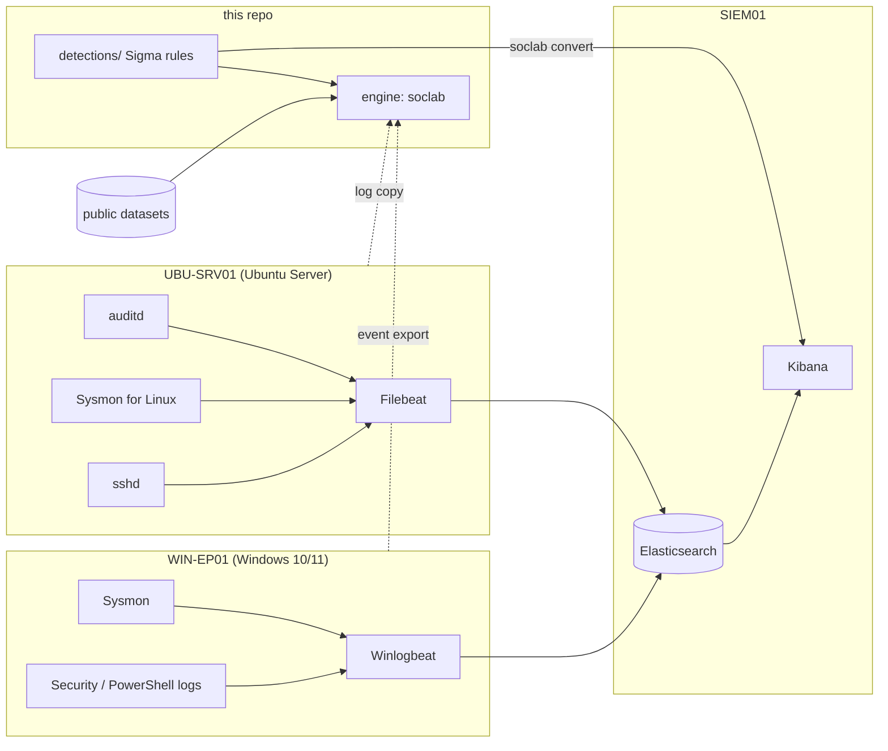

# home-soc-lab

A detection-engineering project built around a small home SOC lab: the lab as
code for a Windows and Linux setup, an attack-simulation plan mapped to MITRE
ATT&CK, a set of Sigma rules, a Sigma evaluator written for this repo, and
incident write-ups.

The lab (two endpoints plus an Elasticsearch/Kibana SIEM) is fully described
and configured here, but it was not built or run while writing the repo: the
machine this was developed on had no hypervisor, no Docker daemon and no root.
So instead of inventing log data, the detection pipeline is validated against
**real recorded attack telemetry from public datasets** (OTRF Security-Datasets
and splunk/attack_data). Every number in the write-ups comes from running this
repo's engine over that data.

## What is here

| Directory | Contents |
|---|---|
| `lab/` | architecture doc, a trimmed Sysmon config, auditd rules, Sysmon-for-Linux config, a Windows audit-policy script, log-shipper configs, a single-node Elasticsearch/Kibana docker-compose, and a setup guide |
| `attacks/` | the attack-simulation plan mapped to ATT&CK with Atomic Red Team test IDs, and benign emulation scripts to run in your own lab |
| `detections/` | 19 Sigma rules (12 Windows, 7 Linux) with ATT&CK tags, levels and false-positive notes |
| `engine/` | `soclab`, a small Sigma evaluator and CLI, with optional pySigma conversion to Splunk / Elastic queries |
| `data/` | a download script for the specific public datasets used (large data is gitignored, never committed) |
| `tests/` | pytest: evaluator unit tests, normaliser tests, and per-rule tests against real fixtures |
| `reports/` | five incident write-ups, each a real dataset run through the engine |
| `coverage/` | the ATT&CK coverage table and a Navigator layer |

## Architecture



Two ways to run the detections: convert each Sigma rule to a Kibana (Lucene) or
Splunk query with `soclab convert`, or run the rules directly over exported
JSON/JSONL and raw auditd/Sysmon logs with `soclab run`. The write-ups use the
second path, which needs no SIEM.

## Quick start

```
python3 -m venv .venv
. .venv/bin/activate
pip install -e '.[convert,dev]'      # drop [convert] to skip the pySigma backends

python -m pytest -q                  # run the test suite
soclab list-rules --rules detections # list the rules

python3 -I data/fetch.py linux       # download a dataset group (gitignored)
soclab run --rules detections data/events/*.log
soclab convert --target lucene detections
```

## Coverage

19 Sigma rules across 20 ATT&CK techniques; full table in
[`coverage/attack_coverage.md`](coverage/attack_coverage.md), with a Navigator
layer in [`coverage/navigator_layer.json`](coverage/navigator_layer.json).

Credential Access (T1003.001/.002/.003), Execution (T1059.001/.004, T1569.002,
T1053.005), Defense Evasion (T1218.005/.010, T1140, T1197), Persistence
(T1547.001, T1546.003, T1098.004, T1136.001, T1505.003), Privilege Escalation
(T1548.002), Initial Access (T1190), Lateral Movement (T1543.003) and Command
and Control (T1105).

## Results

The test suite is 106 tests: evaluator and normaliser unit tests, and per-rule
tests that each rule fires on a real attack fixture and stays silent on benign
events from the same dataset. All pass.

The five write-ups in [`reports/`](reports/) each investigate a real dataset:

| Write-up | What the engine found |
|---|---|
| LSASS credential theft after Metasploit access | service install + comsvcs LSASS dump, 2 rules over 41,954 events |
| AD database theft via shadow copy | vssadmin shadow copy + SYSTEM hive export on a DC, 2 rules |
| Log4Shell exploitation and reverse shell | shell spawned by the Tomcat JVM + reverse-shell callback, 2 rules |
| WMI event subscription persistence | the subscription create + the encoded PowerShell it ran, 2 rules |
| UAC bypass via fodhelper | the shell-open-command hijack writes + the elevated PowerShell, 2 rules |

## Limits

- The lab is configured but not stood up here, so the shippers, the SIEM
  pipeline and the Windows/Linux audit configs are described from vendor docs
  and checked only as far as syntax and `docker compose config`, not by running
  them end to end. Each file says so at the top.
- The engine implements only the slice of Sigma the rules use (documented in
  `engine/soclab/sigma.py`); it is not a full Sigma engine.
- The Linux-rule-to-Kibana path needs a pySigma pipeline for Filebeat's field
  names, which is not written yet (`lab/SETUP.md`, section 5).
- The datasets are other people's recordings; the detections are validated
  against them, not against telemetry from a lab I ran.

## Next steps

- Build the lab from `lab/SETUP.md` and run the Atomic Red Team tests in
  `attacks/README.md`, then re-run `soclab` on the real exports to confirm the
  rules fire on first-party data.
- Write rules for the collected-but-unused sources: Security 4688, PowerShell
  4104 script block logs, and sshd auth logs (SSH brute force and new-key use).
- Add the detections called out as gaps in the write-ups: a burst of
  `reg export` / `reg save`, a script host whose parent is `WmiPrvSE.exe`, and
  the sdclt / eventvwr UAC-bypass variants.
- Add a pySigma processing pipeline for the Linux rules so `soclab convert`
  produces Kibana queries that match Filebeat's ECS field names.
- Turn the single-rule building blocks into correlation rules (for example,
  shadow copy + SYSTEM hive export on a DC within a short window).

## Attribution and licences

This repo is MIT (`LICENSE`). It builds on, and credits in place:

- Sysmon config layout: SwiftOnSecurity/sysmon-config (CC BY 4.0) and
  olafhartong/sysmon-modular (MIT).
- Sysmon-for-Linux config: microsoft/MSTIC-Sysmon (MIT).
- auditd rules: Neo23x0/auditd (Apache-2.0).
- Attack test IDs: redcanaryco/atomic-red-team (MIT).
- Datasets: OTRF/Security-Datasets (MIT) and splunk/attack_data (Apache-2.0);
  see `data/README.md` and `tests/fixtures/SOURCES.md`.
- Rule conversion uses pySigma and its Splunk/Elasticsearch backends.
